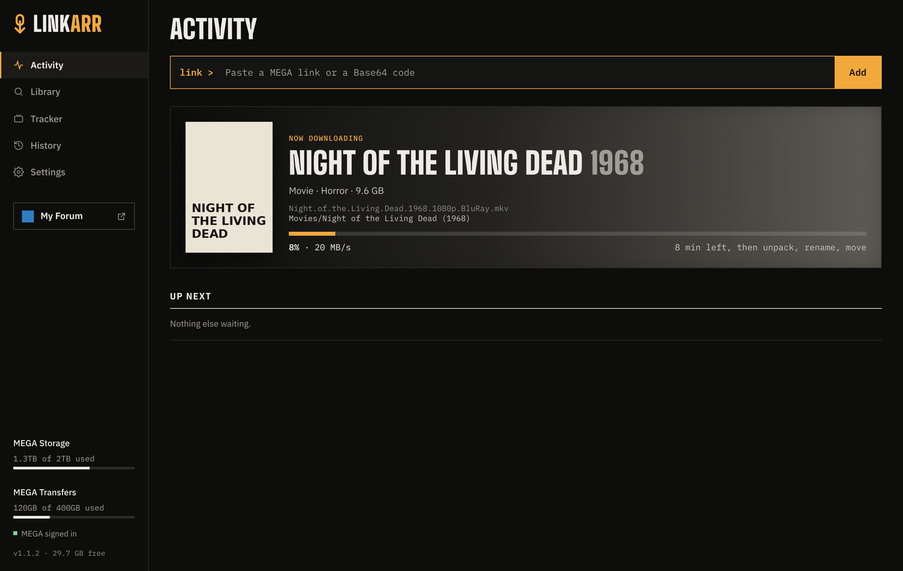
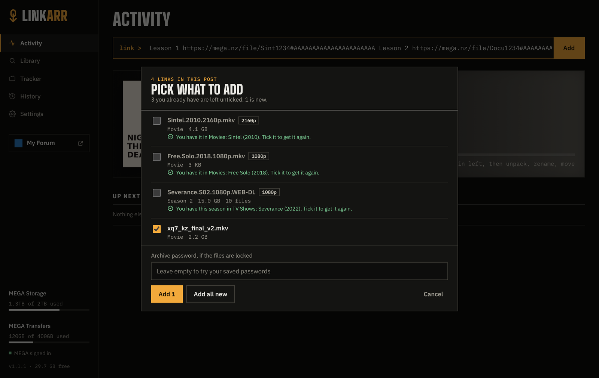
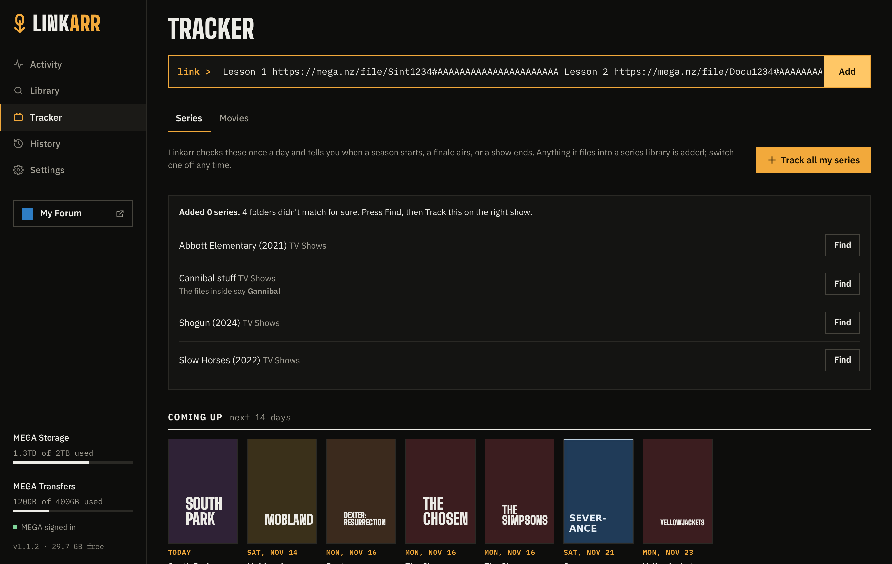
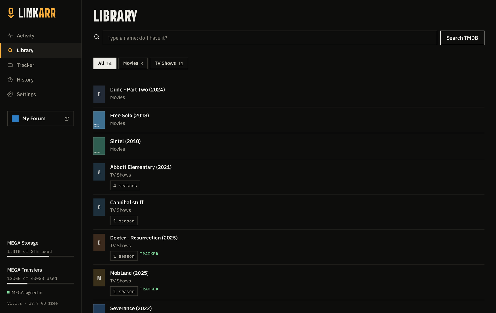
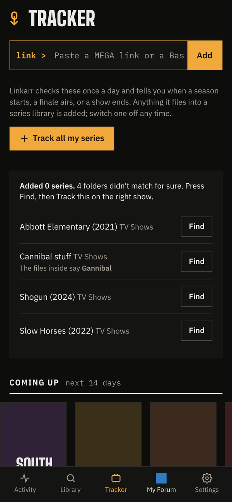

# Linkarr

<!-- INTRODUCTION: replace this paragraph with your own words. -->
Before you ask: yes, this was vibe coded with Claude. I’m not a developer by trade. I built it to scratch my own itch, and now I use it every day.

Linkarr started as a fix for my own niche problem: getting MEGA links into Plex without the busywork. It turned out more useful than I expected, so I’m sharing it in case it helps you too.

If it’s useful to you, great. If not, no hard feelings



Paste a MEGA link or a Base64 code. Linkarr downloads it with **your own** MEGA account,
names it the way Plex expects, and files it in the right library. One Docker container, runs on
your own server.

## What it does

- **Paste a link or a code.** Base64 codes are decoded again and again until a MEGA or captcha link comes out.
- **Several links at once.** You pick what to add, and what you already have is left unticked.
- **Send to Linkarr bookmark.** Picks up the MEGA links on the page you're looking at. Linkarr itself never visits any site.
- **Names and files it.** `Movie (Year)/Movie (Year).mkv`, `Show (Year)/Season 2/Show - S02E01.mkv`.
- **Unpacks and cleans up.** zip, rar and 7z, passwords too. Samples and junk go.
- **Never overwrites.** Replaced files sit in a recycle folder for 7 days. Every move can be undone.
- **Tracks your shows.** New episodes, missing episodes, finales and cancellations.
- **Tells Plex.** Plex, Jellyfin or Emby scan the right library when something lands.
- **Telegram bot.** Send links from your phone and answer questions with buttons.
- **Watches your MEGA quota.** Holds a download that wouldn't fit until there's room.

[Everything it does](docs/features.md)

## Screenshots

| Pick what to add | Coming up |
|---|---|
|  |  |
| **Do I have it?** | **On your phone** |
|  |  |

## Quick start

```yaml
services:
  linkarr:
    image: ghcr.io/xsil0/linkarr-app:latest
    container_name: linkarr
    restart: unless-stopped
    ports:
      - "9040:9040"
    environment:
      - TZ=Europe/London        # your time zone
      - PUID=1000               # user and group that own your media folders
      - PGID=1000
    volumes:
      - ./linkarr-data:/data    # database, keys, MEGA session, logs, backups
      - /path/to/media:/media   # the one folder that holds Movies, TV Shows and so on
```

```
docker compose up -d
docker logs linkarr          # the one-time setup code is here
```

Open `http://<server>:9040`, enter the setup code and make your account. Then in **Settings**:

1. **Libraries:** add your folders (`Movies` means `/media/Movies`).
2. **Accounts:** sign in to MEGA and add a free TMDB API key.
3. **Media servers** and **Telegram:** optional.
4. **Setup check:** shows anything still missing.

Step by step with pictures: the [setup guide (PDF)](docs/Linkarr-setup-guide.pdf). On Unraid, see the [Unraid notes](docs/unraid.md). Keep Linkarr off the open internet: it holds your
MEGA session. See [SECURITY.md](SECURITY.md). All container variables and settings are in
[docs/features.md](docs/features.md#settings-reference).

## Captcha links are held, never bypassed

Linkarr never solves or gets around captchas or link protectors. It holds the link, you solve it
yourself, and paste back the MEGA link. Pull requests that automate this won't be accepted.

## Your responsibility

Linkarr is a tool for organizing files you have the right to download and keep, such as your own
uploads, files shared with you by their owner, or content that is free to share. You are responsible
for what you download with it and for following the law where you live and the terms of the services
you use (MEGA, TMDB, Plex, Telegram, OpenSubtitles). Linkarr doesn't find, host or share any content,
and it isn't affiliated with any of those services.

## Development


```
python -m venv .venv && . .venv/bin/activate
pip install -r requirements-dev.txt
python -m pytest -q
LA_DATA=./data LA_MEDIA=./media python -m linkarr
```

The tests use fakes for MEGA, TMDB, Telegram and Plex; nothing touches the internet.

## License

[MIT](LICENSE). The bundled fonts, IBM Plex and Big Shoulders Display, are under the SIL Open Font
License; the licence texts are in `linkarr/web/fonts/`.
